# Cross-dataset comparison of three PV defect papers (P1, P2, P3)

Inference-only study for the review paper. Every model is the **final trained model of our reproduction**
(`models/`, unchanged, no re-training, no fine-tuning). Each one is run on the evaluation split of **all three papers'
datasets** and scored by **one evaluator** with the same metrics. Date: 2026-10-22. Machine: RTX 4050 Laptop 6 GB,
Windows 11.

| ID | Paper | Task | Dataset (eval split) | Models compared |
|---|---|---|---|---|
| **P1** | Li et al. 2023, *GBH-YOLOv5* (Electronics 12, 561) | box detection, 5 classes | PV-Multi-Defect, val 222 imgs, 600×600 module crops | YOLOv5s (v5.0), GBH-YOLOv5 |
| **P2** | Mazen et al. 2023, *Deep Learning for Automatic Defect Detection in PV Modules Using EL Images* (IEEE Access 11) | box detection, 6 classes | ELDDS1400C5, test 190 imgs, 640×640 whole EL panels | YOLOv5s (v7.0), YOLOv5s+GAM+ASFF+DIoU ("Improved"), YOLOv8s |
| **P3** | Deitsch et al. 2019, *Automatic classification of defective PV module cells in EL images* (Solar Energy 185) | cell classification, defective vs functional | ELPV, test 656 cells, 300×300 | VGG-19 CNN (seed 0) |

## TL;DR (for the review)

1. **No model transfers.** On a foreign dataset, every detector falls to a class-agnostic mAP@.5 of **0.004–0.053**,
   against 0.46–0.82 at home (Fig. 1). The best defective-vs-functional tile AUC any model reaches on a foreign
   dataset is **0.61**, against 0.88–0.98 at home (Fig. 2). 7 of the 12 cross cells are at chance (AUC CI includes
   0.5).
2. **The transfer is asymmetric.** P1's models (trained on cropped, zoomed-in module images) keep a weak but
   significant signal on ELDDS and ELPV: tile AUC 0.58–0.61, with CIs that exclude 0.5. On ELDDS they get it by
   flagging most tiles (68–84 %): recall 0.74–0.88 at precision 0.26–0.27, against a defective share of 0.25. P2's
   models (trained on whole panels) are at chance on P1 and P3 data. The P3 CNN is at chance on P1 data (0.50) and
   weakly above chance on ELDDS (0.59).
3. **The one defect concept that transfers is the dark, unpowered area (cell or string).** P2's models recover
   **50–56 %** of P1's `no_electricity` boxes (IoU 0.5), and ≤ 17 % of every other P1 class (Fig. 6). These boxes are
   whole dark cell columns, and P2's models label them `ShortCircuitString` (Fig. 7). P1's models localise 27–30 % of
   ELDDS `Crack` boxes, but they label them `scratch`. With the classes mapped by visual similarity (crack / line /
   dark, §3.1), cross mAP@.5 is still only **0.047–0.133** against 0.68–0.81 at home. `dark` is the one shared class
   with real transfer: P2 → P1 AP 0.13–0.35, on 36 GT boxes, so the CIs are wide (0.03–0.60). `crack` has none (AP
   ≤ 0.03). Fixing the taxonomy mismatch alone doesn't restore transfer.
4. **The papers' headline improvements are small or absent, even at home** (paired bootstrap, §3.2). GBH-YOLOv5 is
   *below* its own YOLOv5s baseline: class-aware mAP@.5 0.823 vs 0.856, difference −0.033 [−0.061, −0.007];
   class-agnostic −0.055. P2-Improved equals YOLOv5s (+0.003 [−0.008, +0.015]). YOLOv8s is +0.015 [+0.003, +0.028]
   above YOLOv5s, and class-agnostic all three are tied. Across datasets the differences are a few hundredths, e.g.
   GBH +0.017 mAP@.5 over YOLOv5s on ELDDS. None of them changes the picture of transfer.
5. **Reported numbers are not comparable across the papers.** The three datasets differ in several ways:
   - imaging: whole panel vs crop vs single cell;
   - scale: an ELDDS cell is ≈ 85 × 35 px (panels stretched to 640 × 640), an ELPV cell 300 × 300 px;
   - taxonomy: no shared class names;
   - annotation granularity: ELDDS has 1161 tiny MicroCrack boxes in its test split, median 15 × 21 px.

   Each paper's metric is tied to its own dataset. A cross-dataset benchmark, with a shared taxonomy *and* varied
   acquisition, is the gap a review should point out.

---

## 1. Protocol

**Inference only.** Weights: `models/p1/{yolov5s,gbh_yolov5}.pt`, `models/p2/{yolov5s,yolov5s_gam_asff,yolov8s}.pt`,
`models/p3/cnn_vgg19_seed0.h5`. Each model keeps **its own paper's inference settings**: input size (P1 960 px,
P2 640 px, P3 300 px), its own codebase and NMS (P1/P2-YOLOv5 conf 0.001, IoU 0.6; YOLOv8 IoU 0.7; DIoU-NMS for
P2-Improved), fp16 for the detectors.

The class lists share no names (P1: broken, hot_spot, black_border, scratch, no_electricity; P2: Examined,
ShortCircuitString, ShortCircuitCell/LowPowerCell, Crack, MicroCrack, OtherError; P3: no boxes, only
defective/functional). So the comparison uses two shared tasks that every pair of model and dataset can be scored on.

**Task A: class-agnostic detection** (5 detectors × 2 box datasets). Every defect class is merged into one `defect`
class. ELDDS `Examined` (the panel outline, not a defect) is removed from GT and from P2's predictions. Merged
predictions get class-agnostic NMS at the model's own IoU, max 300 per image. Metrics: P, R, mAP@.5, mAP@.5:.95.
Variant (§3.1): **class-mapped detection**. The classes with a visual counterpart are mapped onto shared classes
crack / line / dark and scored class-aware; the others are dropped.

**Task B: defective-vs-functional tiles** (6 models × 3 datasets). This is P3's task, so the cell classifier can run on
the module datasets. The tile size aims at "about one cell":
- PV-Multi-Defect: 4×4 grid of 150 px tiles (3552 tiles, 513 defective).
- ELDDS: 6×6 grid over the panel region, i.e. the GT `Examined` box (6840 tiles, 1716 defective). That is ≈ 2 cells
  per tile: P2 reports 109,200 cells in 1,400 panels = 78 per panel, laid out 6 across × 13 down.
- ELPV: each cell is a tile (656, 269 defective; defective iff p > 0, as in P3).

A tile is defective iff a GT defect-box centre lies in it. **CNN score** = its output on the tile crop resized to
300×300 (P3's exact input pipeline). **Detector score** = max confidence of its defect boxes whose centre lies in the
tile (on ELPV: any box on the cell). Metrics: AUC (threshold-free, primary), plus accuracy, macro-F1 and
defective-class P/R/F1 at **pre-declared** thresholds: CNN 0.5 (P3), detectors conf 0.25 (yolov5 `detect.py` /
ultralytics `predict` default). Nothing is tuned on any test set.

**Uncertainty:** 95 % CIs from 1000 bootstrap resamples over images (all tiles of an image stay together), seed 0.

**Evaluator validity.** mAP is our numpy re-implementation of yolov5 v7.0 `utils/metrics.py` + `val.py` matching
(same algorithm as GBH's v5.0 `test.py` and ultralytics). On each model's home dataset and its own classes it
reproduces our official val-script numbers to within ≤ 0.009 mAP@.5. The likely cause of the residual is input
padding: the val scripts' loader (`rect`, pad 0.5 stride) feeds these square images at 992 × 992 (P1) or 672 × 672
(P2), with a 16 px border. Our dumps feed exactly 960 / 640. We have not isolated this. The tile pipeline reproduces the P3 CNN's home result
**exactly** (acc_w 86.49, F1_w 84.20, AUC_w 90.18 = `results/p3/cnn/test_metrics.json`).

| Model (home) | official val script mAP@.5 / mAP@.5:.95 | this evaluator |
|---|---|---|
| P1 YOLOv5s (PV) | 0.865 / 0.529 | 0.856 / 0.527 |
| P1 GBH-YOLOv5 (PV) | 0.821 / 0.513 | 0.823 / 0.521 |
| P2 YOLOv5s (ELDDS) | 0.754 / 0.516 | 0.748 / 0.506 |
| P2 Improved, DIoU-NMS (ELDDS) | 0.757 / 0.514 | 0.750 / 0.504 |
| P2 YOLOv8s (ELDDS) | 0.764 / 0.550 | 0.762 / 0.545 |

## 2. Home results: paper claim vs our reproduction (context)

From `CHECKLIST.md` §6–8 and `init.md` (each paper's own metric and split). The full claim-by-claim check, including the ablations and the papers' internal inconsistencies, is in `CLAIMS.md`.

| Paper | Model | Paper reports | Our reproduction | Note |
|---|---|---|---|---|
| P1 | YOLOv5s | mAP@.5 78.1 | **86.5** | baseline stronger than reported |
| P1 | GBH-YOLOv5 | mAP@.5 97.8 | **82.1** | claimed +19.7 gain not reproduced (below our baseline) |
| P2 | YOLOv5s | mAP@.5 0.739 (no TTA) | **0.754** | |
| P2 | YOLOv5s+GAM+ASFF+DIoU | 0.762 | **0.757** | gain over YOLOv5s +0.003 (paper +0.023) |
| P2 | YOLOv8s | 0.765 | **0.764** | |
| P3 | VGG-19 CNN | acc 88.42 / F1 88.39 | **acc_w 86.49 / F1_w 84.20** (3 seeds: 85.78 ± 0.76) | |

Class-aware home mAP@.5 with this evaluator, also over **defect classes only**. P2's paper metric includes the
`Examined` panel-outline class at AP 0.995, which lifts P2's mean by about 0.05:

| Model | mAP@.5 (paper classes) | mAP@.5 defect classes only | weakest class (AP@.5) |
|---|---|---|---|
| P1 YOLOv5s | 0.856 | 0.856 | scratch 0.649 |
| P1 GBH-YOLOv5 | 0.823 | 0.823 | scratch 0.649 |
| P2 YOLOv5s | 0.748 | 0.698 | MicroCrack 0.362 |
| P2 Improved | 0.750 | 0.701 | MicroCrack 0.339 |
| P2 YOLOv8s | 0.762 | 0.716 | MicroCrack 0.328 |

## 3. Task A: cross-dataset detection (class-agnostic)

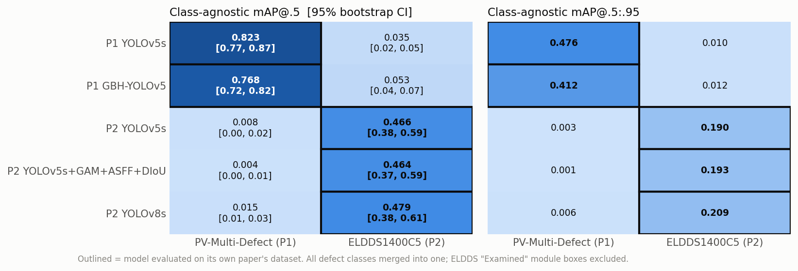

| Model | Dataset | | P | R | mAP@.5 [95 % CI] | mAP@.5:.95 |
|---|---|---|---|---|---|---|
| P1 YOLOv5s | PV-Multi-Defect | home | 0.781 | 0.827 | **0.823** [0.771, 0.868] | 0.476 |
| P1 YOLOv5s | ELDDS1400C5 | cross | 0.147 | 0.046 | 0.035 [0.024, 0.049] | 0.010 |
| P1 GBH-YOLOv5 | PV-Multi-Defect | home | 0.728 | 0.835 | **0.768** [0.715, 0.821] | 0.412 |
| P1 GBH-YOLOv5 | ELDDS1400C5 | cross | 0.213 | 0.071 | 0.053 [0.040, 0.069] | 0.012 |
| P2 YOLOv5s | PV-Multi-Defect | cross | 0.035 | 0.035 | 0.008 [0.004, 0.021] | 0.003 |
| P2 YOLOv5s | ELDDS1400C5 | home | 0.509 | 0.556 | **0.466** [0.378, 0.593] | 0.190 |
| P2 Improved | PV-Multi-Defect | cross | 0.014 | 0.053 | 0.004 [0.002, 0.007] | 0.001 |
| P2 Improved | ELDDS1400C5 | home | 0.521 | 0.549 | **0.464** [0.372, 0.590] | 0.193 |
| P2 YOLOv8s | PV-Multi-Defect | cross | 0.091 | 0.031 | 0.015 [0.007, 0.032] | 0.006 |
| P2 YOLOv8s | ELDDS1400C5 | home | 0.553 | 0.550 | **0.479** [0.377, 0.611] | 0.209 |

Class-agnostic ELDDS mAP (0.46–0.48) is lower than P2's class-aware number (0.70–0.72 over defect classes) because
it is box-weighted. The two weakest classes, MicroCrack (1161 boxes, AP ≈ 0.34) and OtherError (911, AP ≈ 0.52), make
up 89 % of the merged class, while class-aware mAP averages the 5 classes equally.

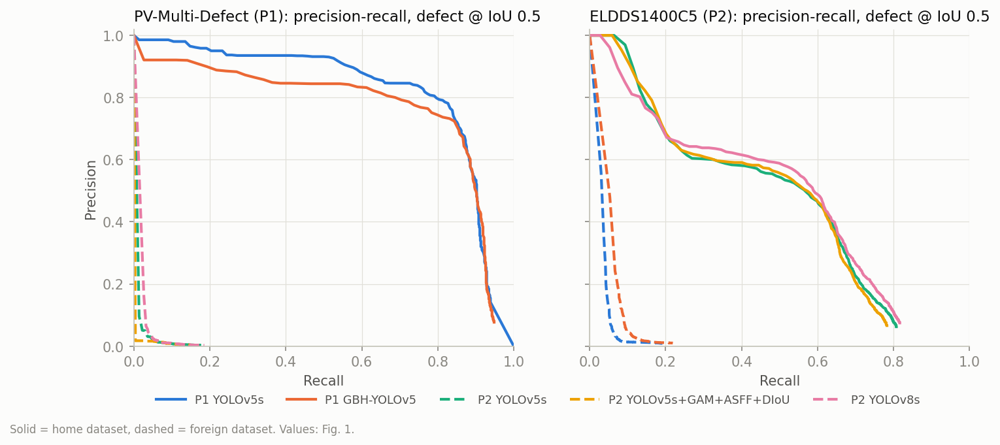

**Which defects a foreign model still finds.** Recall per GT class, IoU 0.5, conf ≥ 0.25, class-agnostic matching:

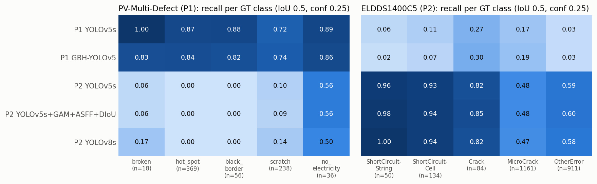

- P2 models on P1 data find **no_electricity 0.50–0.56**. These boxes are whole dark cell columns (median 152 ×
  594 px), the counterpart of P2's ShortCircuitString, which is what P2's models call them (§3.1). broken
  0.06–0.17, scratch 0.09–0.14, hot_spot and black_border **0.00**.
- P1 models on ELDDS find Crack 0.27–0.30, MicroCrack 0.17–0.19, ShortCircuitCell 0.07–0.11, ShortCircuitString
  0.02–0.06, OtherError 0.03. This is class-agnostic matching; §3.1 shows which class the models assign.

### 3.1 Class-mapped detection (shared classes)

Instead of merging everything into one `defect` class, the classes with a visual counterpart in the other dataset
are mapped onto three shared classes. Classes without a counterpart are dropped from GT and from predictions:

| Shared class | PV-Multi-Defect (P1) | ELDDS1400C5 (P2) | appearance in EL |
|---|---|---|---|
| **crack** | broken | Crack | dark star / wedge-shaped crack |
| **line** | scratch | MicroCrack | short thin dark line |
| **dark** | no_electricity | ShortCircuitString + ShortCircuitCell/LowPowerCell | dark cell column/string (PV, ELDDS string) or single dark cell (ELDDS cell) |
| *dropped* | hot_spot (bright patch), black_border (dark strip at a cell edge) | OtherError (grab-bag), Examined (outline) | no counterpart |

The mapping comes from GT crops of every class and is confirmed by what each paper's models predict on the other
dataset (Fig. 7). In both directions, the mapped counterpart is the class a foreign model most often predicts for
that GT class. There are two exceptions: crack (below), and ELDDS ShortCircuitCell, which P1 calls *scratch* (0.18)
about as often as *no_electricity* (0.15).
- P2's models call PV no_electricity *ShortCircuitString* (0.74). P1's models call ELDDS ShortCircuitString
  *no_electricity* (0.69).
- ELDDS MicroCrack becomes P1 *scratch* (0.63), and PV scratch becomes P2 *MicroCrack* (0.18; 0.78 are missed).
- Crack is the weak pair. P1's models call ELDDS Crack *scratch* (0.50) more often than *broken* (0.04). P2's models
  call PV broken *MicroCrack* (0.24). So a coarse variant merges crack + line into one class.
- P1's dropped classes are invisible to P2's models: 0.00 of hot_spot and 0.01 of black_border are detected. P1
  calls 0.27 of ELDDS OtherError *scratch*. OtherError is a mix of defect types, so it stays unmapped.

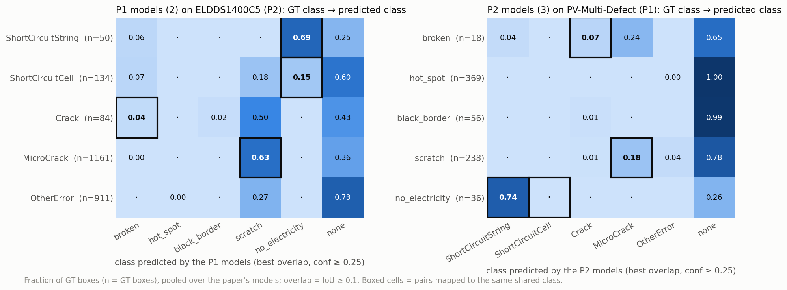

Each model's predictions go through its home dataset's map. A shared class that merges two of the model's classes
(P2 `dark`; `crack/line` in the coarse variant) is re-NMSed at the model's IoU; every other class keeps the model's
own output. Home and cross are scored in the same shared space, class-aware, with the same AP code and bootstrap as
§3. Check: each unmerged home AP equals the class-aware per-class AP of the home evaluation within 0.001
(`results/cross/tables.md`; e.g. P1 v5s broken 0.861, P2 v8s Crack 0.793).

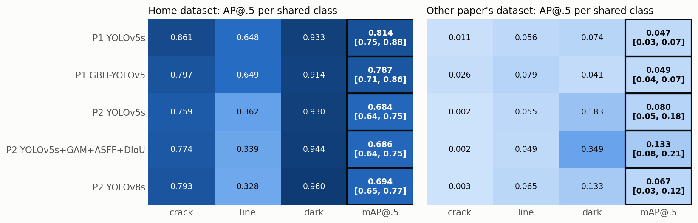

| Model | Dataset | | crack | line | dark | mAP@.5 [95 % CI] | coarse mAP@.5 [95 % CI] |
|---|---|---|---|---|---|---|---|
| P1 YOLOv5s | PV-Multi-Defect | home | 0.861 | 0.648 | 0.933 | **0.814** [0.747, 0.876] | 0.808 [0.747, 0.863] |
| P1 YOLOv5s | ELDDS1400C5 | cross | 0.011 | 0.056 | 0.074 | 0.047 [0.032, 0.071] | 0.066 [0.045, 0.097] |
| P1 GBH-YOLOv5 | PV-Multi-Defect | home | 0.797 | 0.649 | 0.914 | **0.787** [0.710, 0.859] | 0.795 [0.739, 0.862] |
| P1 GBH-YOLOv5 | ELDDS1400C5 | cross | 0.026 | 0.079 | 0.041 | 0.049 [0.036, 0.067] | 0.065 [0.049, 0.087] |
| P2 YOLOv5s | ELDDS1400C5 | home | 0.759 | 0.362 | 0.930 | **0.684** [0.637, 0.752] | 0.663 [0.607, 0.742] |
| P2 YOLOv5s | PV-Multi-Defect | cross | 0.002 | 0.055 | 0.183 | 0.080 [0.046, 0.183] | 0.112 [0.061, 0.251] |
| P2 Improved | ELDDS1400C5 | home | 0.774 | 0.339 | 0.944 | **0.686** [0.641, 0.752] | 0.659 [0.607, 0.747] |
| P2 Improved | PV-Multi-Defect | cross | 0.002 | 0.049 | **0.349** | 0.133 [0.076, 0.208] | 0.190 [0.101, 0.312] |
| P2 YOLOv8s | ELDDS1400C5 | home | 0.793 | 0.328 | 0.960 | **0.694** [0.648, 0.773] | 0.666 [0.616, 0.759] |
| P2 YOLOv8s | PV-Multi-Defect | cross | 0.003 | 0.065 | 0.133 | 0.067 [0.030, 0.115] | 0.093 [0.038, 0.159] |

GT boxes kept: PV crack 18, line 238, dark 36 (292 of 717); ELDDS crack 84, line 1161, dark 184 (1429 of 2340).
The PV crack and dark APs therefore rest on 18 and 36 boxes. Per-class 95 % CIs are in
`results/cross/tables_paired.md`; e.g. P2-Improved cross dark 0.349 [0.183, 0.604]. Full tables (P, R,
mAP@.5:.95, confusion counts): `results/cross/tables_classmap.md`.

- **Aligning the taxonomy doesn't rescue transfer.** Cross mAP@.5 is **0.047–0.133** against 0.68–0.81 at home,
  and at most 0.19 in the coarse variant. The class mismatch is therefore not the main cause of the collapse. Since
  input size doesn't explain it either (§6, S1), the remaining explanation is the image domain (field of view,
  scale, acquisition); that is an inference, not tested directly.
- **`dark` is the only class that partly transfers**, and only from P2 to P1: AP 0.13–0.35. P2-Improved's 0.349 is the
  highest cross-dataset AP in the study, but its CI is wide. P1's models reach only 0.04–0.07 on ELDDS dark, for two
  reasons:
  - They label 69 % of ELDDS ShortCircuitStrings `no_electricity` at loose overlap (IoU ≥ 0.1), but their boxes
    don't fit the string: recall at IoU 0.5 is 0.02–0.06.
  - They label only 15 % of the single dark cells (ShortCircuitCell) `no_electricity`.
- **`crack` doesn't transfer at all** (AP ≤ 0.026), although the two classes look alike. Each dataset's cracks get
  detected as the other's thin-line class, or missed.
- P2-on-PV rises from 0.004–0.015 (class-agnostic, §3) to 0.067–0.133 here, for two reasons:
  - The 425 hot_spot and black_border boxes (59 % of PV defects), which P2's models never detect, are out of the
    score.
  - The 36 dark boxes now carry a third of the mean, instead of 5 % of the merged class.

  P1-on-ELDDS barely moves (0.035–0.053 → 0.047–0.049).
- Architecture differences (paired, §3.2):
  - P1: GBH vs YOLOv5s is not significant in the mapped space, home or cross.
  - P2 cross: YOLOv8s is below Improved (−0.066 [−0.152, −0.017]). Improved vs YOLOv5s is not significant
    (+0.053 [−0.004, +0.091]). These differences come almost entirely from the 36-box dark class.

### 3.2 Are the architecture differences real? (paired bootstrap)

Two models scored on the same images are compared on the *same* 1000 image resamples, so the CI is on the
difference. Overlapping per-model CIs are not a test. Bold = CI excludes 0. All rows, including the mapped space:
`results/cross/tables_paired.md` (`paired_tests.py`).

| A − B | home class-aware mAP@.5 | home class-agnostic | cross class-agnostic | home tile AUC | cross tile AUC (other box dataset / ELPV) |
|---|---|---|---|---|---|
| GBH − YOLOv5s (P1) | **−0.033** [−0.061, −0.007] | **−0.055** [−0.086, −0.017] | **+0.017** [+0.009, +0.027] | −0.000 [−0.009, +0.008] | **+0.031** [+0.011, +0.049] / +0.006 [−0.034, +0.049] |
| Improved − YOLOv5s (P2) | +0.003 [−0.008, +0.015] | −0.001 [−0.013, +0.011] | **−0.004** [−0.017, −0.001] | +0.002 [−0.003, +0.007] | +0.020 [−0.002, +0.042] / **+0.067** [+0.022, +0.111] |
| YOLOv8s − YOLOv5s (P2) | **+0.015** [+0.003, +0.028] | +0.014 [−0.002, +0.032] | +0.007 [−0.005, +0.018] | −0.001 [−0.013, +0.009] | +0.006 [−0.017, +0.028] / +0.038 [−0.004, +0.075] |
| YOLOv8s − Improved (P2) | +0.012 [−0.000, +0.026] | +0.015 [−0.000, +0.034] | **+0.011** [+0.004, +0.027] | −0.003 [−0.013, +0.007] | −0.015 [−0.040, +0.011] / **−0.030** [−0.056, −0.004] |

P2 class-aware uses P2's 6 classes, as in its paper. Over the 5 defect classes only, YOLOv8s − YOLOv5s = **+0.018**
[+0.006, +0.033] and YOLOv8s − Improved = **+0.015** [+0.000, +0.031].

- **GBH-YOLOv5 is worse than its own baseline at home**: −0.033 class-aware, −0.055 class-agnostic (uncorrected CIs
  exclude 0).
  It is slightly better across datasets (+0.017 mAP@.5 and +0.031 tile AUC on ELDDS), but at a level of
  0.05 mAP@.5 and 0.61 AUC.
- **P2-Improved (GAM + ASFF + DIoU-NMS) is not distinguishable from YOLOv5s at home** on any metric. Its one
  significant cross gain (+0.067 tile AUC on ELPV) moves it from 0.457 to 0.524; both CIs include 0.5.
- **YOLOv8s is the only P2 model whose home gain has a CI excluding 0**: +0.015 class-aware over YOLOv5s; vs Improved
  the CI touches 0. Class-agnostic, the three are tied.
- Across datasets the significant differences are all ≤ 0.07 and leave every model near chance. Architecture
  doesn't decide transfer.
- **Multiplicity.** After a Holm correction over all 35 paired tests (`results/cross/tables_holm.md`), only two cross-dataset differences stay significant (GBH − YOLOv5s on ELDDS: +0.017 mAP@.5, +0.031 tile AUC). Within the 15 home-dataset tests, only GBH's class-agnostic deficit (−0.055, Holm p 0.025) stays significant; its class-aware −0.033 (Holm p 0.19) and YOLOv8s's +0.015 (Holm p 0.22) do not. None of this rescues a claim: the papers' gains (+0.197, +0.023) lie far outside
  every CI.

## 4. Task B: defective vs functional, full 3 × 3

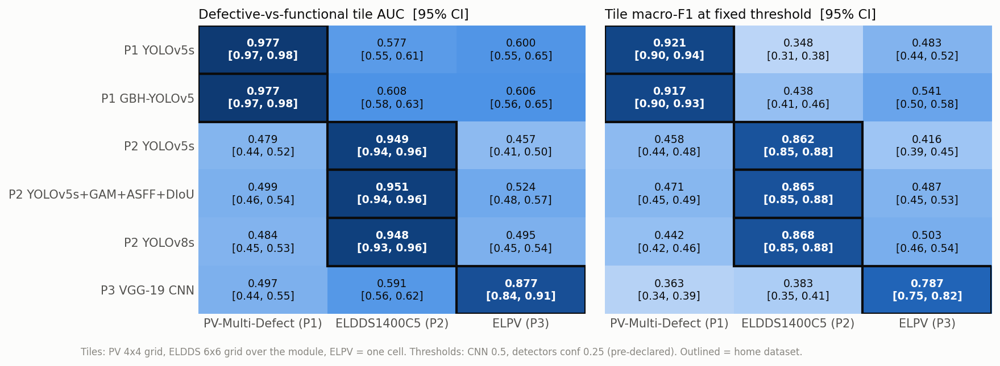

| Model | PV-Multi-Defect AUC [CI] | ELDDS1400C5 AUC [CI] | ELPV AUC [CI] | PV macro-F1 | ELDDS macro-F1 | ELPV macro-F1 |
|---|---|---|---|---|---|---|
| P1 YOLOv5s | **0.977** [0.969, 0.985] | 0.577 [0.547, 0.606] | 0.600 [0.555, 0.646] | **0.921** | 0.348 | 0.483 |
| P1 GBH-YOLOv5 | **0.977** [0.970, 0.984] | 0.608 [0.582, 0.634] | 0.606 [0.563, 0.650] | **0.917** | 0.438 | 0.541 |
| P2 YOLOv5s | 0.479 [0.439, 0.521] | **0.949** [0.938, 0.959] | 0.457 [0.412, 0.504] | 0.458 | **0.862** | 0.416 |
| P2 Improved | 0.499 [0.459, 0.539] | **0.951** [0.939, 0.962] | 0.524 [0.479, 0.566] | 0.471 | **0.865** | 0.487 |
| P2 YOLOv8s | 0.484 [0.446, 0.530] | **0.948** [0.935, 0.959] | 0.495 [0.451, 0.542] | 0.442 | **0.868** | 0.503 |
| P3 VGG-19 CNN | 0.497 [0.444, 0.554] | 0.591 [0.560, 0.624] | **0.877** [0.845, 0.906] | 0.363 | 0.383 | **0.787** |

Bold = home dataset. Full table with accuracy and defective-class P/R/F1: `results/cross/tables.md`.

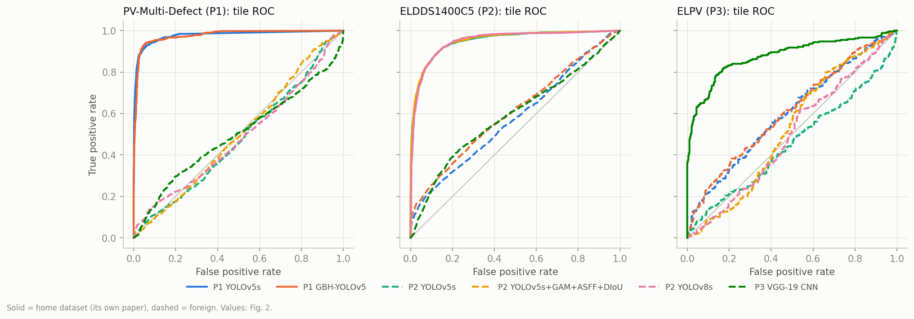

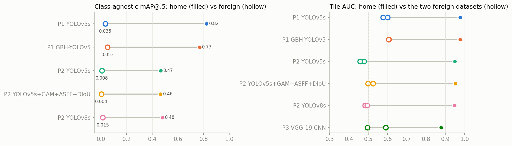

**ELPV under P3's own protocol** (confidence-weighted, as in P3 Table 2):

| Model | acc_w | macro-F1_w | AUC_w |
|---|---|---|---|
| P3 VGG-19 CNN (home) | **86.49** | **84.20** | **90.18** |
| P1 YOLOv5s | 47.65 | 46.83 | 63.40 |
| P1 GBH-YOLOv5 | 53.91 | 53.77 | 63.49 |
| P2 YOLOv5s | 64.89 | 44.11 | 43.32 |
| P2 Improved | 51.73 | 47.36 | 51.64 |
| P2 YOLOv8s | 50.28 | 48.94 | 48.05 |

P2 YOLOv5s's 64.9 % accuracy is an artefact. It calls almost every cell functional (defective recall 0.05), and 59 %
of the ELPV test cells are functional. This is why the comparison relies on AUC and macro-F1, not accuracy.

**How the failures look.** At the fixed thresholds:
- P1 models on ELDDS flag 0.74–0.88 of defective tiles at precision 0.26–0.27, barely above the defective share of
  0.25. In the examples (§5) they respond to the panel's regular dark structure (cell gaps, busbars).
- The CNN on ELDDS has recall 0.78 at precision 0.26.
- P2 models on PV-Multi-Defect flag only 0.31–0.39 of defective tiles, at precision 0.13–0.14, which equals the
  defective share (0.14), i.e. no better than chance.

## 5. Qualitative examples

Detections with conf ≥ 0.25 (all defect classes), the same two images per dataset for every model:

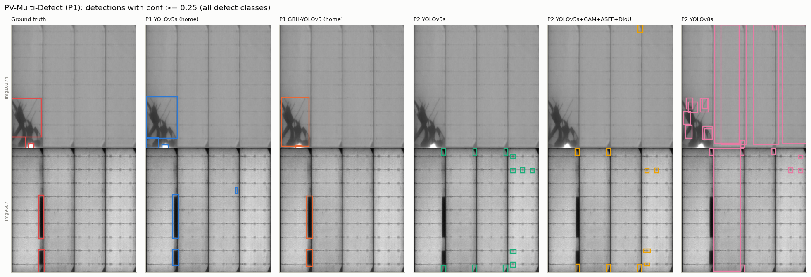

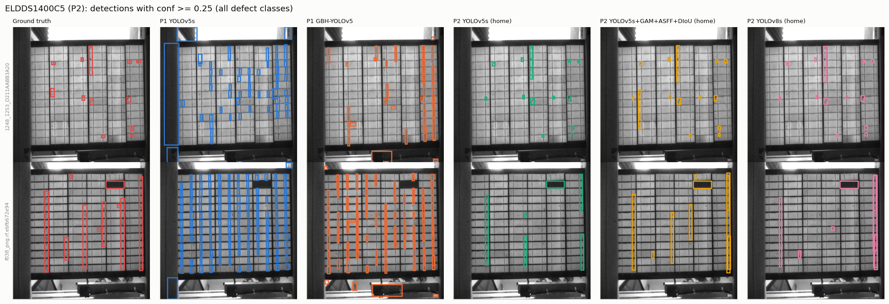

On ELDDS, P1's models draw tall thin boxes along the cell columns and gaps, mostly labelled `scratch` (Fig. 7). On
PV-Multi-Defect, YOLOv8s draws column-height boxes (its ShortCircuitString shape), and both P2 YOLOv5 variants
place small boxes on busbar pads.

ELPV cells with every model's score:

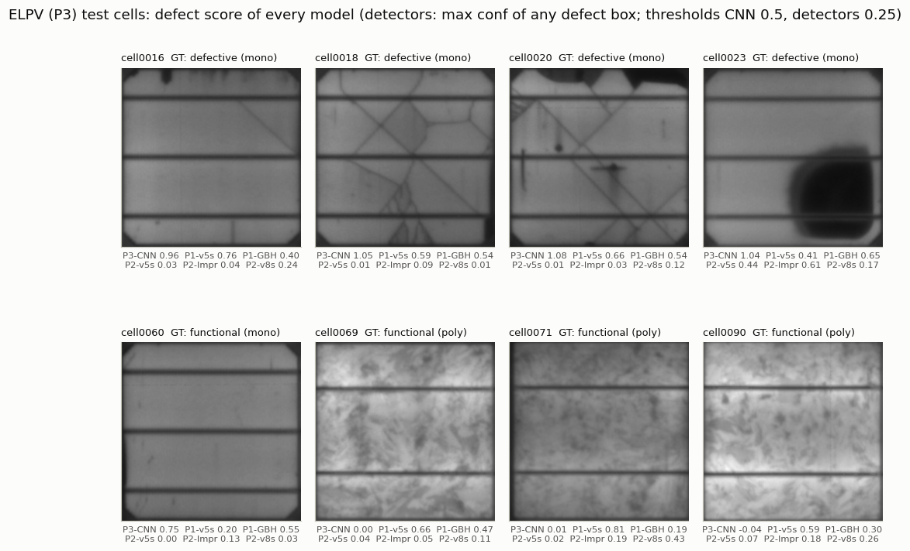

The tile task on an ELDDS panel and a PV-Multi-Defect crop (red intensity = score):

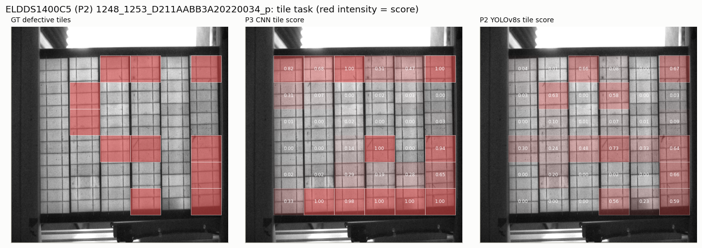

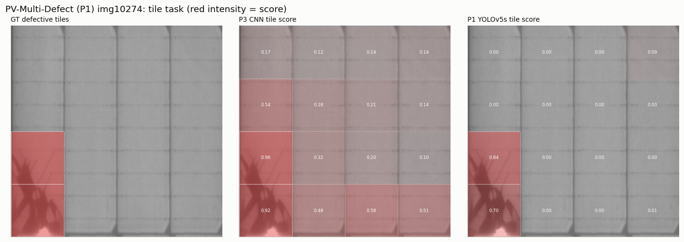

## 6. Sensitivity of the two free choices

Two protocol choices are ours: the detectors' input size on a foreign dataset, and the tile size. Neither changes the
conclusions (`results/cross/tables_sensitivity.md`, `sensitivity.json`).

**S1, input size.** Each detector is re-run on the foreign dataset at *that dataset's* paper input size, instead of its
own:

| Model → foreign dataset | input | class-agnostic mAP@.5 [95 % CI] | tile AUC [95 % CI] |
|---|---|---|---|
| P1 YOLOv5s → ELDDS | 960 (own) / **640** | 0.035 [0.025, 0.049] / **0.047** [0.032, 0.065] | 0.577 / **0.571** |
| P1 GBH-YOLOv5 → ELDDS | 960 / **640** | 0.053 [0.041, 0.067] / **0.012** [0.008, 0.017] | 0.608 / **0.565** |
| P2 YOLOv5s → PV | 640 / **960** | 0.008 [0.005, 0.021] / **0.006** [0.001, 0.012] | 0.479 / **0.489** |
| P2 Improved → PV | 640 / **960** | 0.004 [0.002, 0.007] / **0.001** [0.001, 0.001] | 0.499 / **0.568** |
| P2 YOLOv8s → PV | 640 / **960** | 0.015 [0.008, 0.033] / **0.005** [0.002, 0.013] | 0.484 / **0.514** |

Matching the foreign input size moves cross mAP@.5 by at most 0.04; at the foreign size every cross mAP@.5 is
≤ 0.047. Tile AUC moves by at most 0.07, and the best cross AUC at the foreign size is 0.571. The field-of-view
mismatch is not fixed by resizing.

**S2, tile size on ELDDS.** 12×12 tiles (27,360 tiles, 2,212 defective; about half a cell each) instead of 6×6
(about 2 cells):

| Model | tile AUC 6×6 (main) | tile AUC 12×12 [95 % CI] | macro-F1 12×12 |
|---|---|---|---|
| P1 YOLOv5s | 0.577 | 0.567 [0.533, 0.604] | 0.326 |
| P1 GBH-YOLOv5 | 0.608 | 0.608 [0.573, 0.644] | 0.480 |
| P2 YOLOv5s (home) | 0.949 | 0.956 [0.947, 0.964] | 0.854 |
| P2 Improved (home) | 0.951 | 0.963 [0.954, 0.969] | 0.863 |
| P2 YOLOv8s (home) | 0.948 | 0.959 [0.950, 0.967] | 0.863 |
| P3 VGG-19 CNN | 0.591 | **0.518** [0.479, 0.552] | 0.194 |

The home detectors are insensitive to tile size. The CNN's weak ELDDS signal (0.59) drops to chance at 12×12. This
suggests it responds to multi-cell context rather than localising cell defects in ELDDS panels; the half-cell tiles
are also upscaled about 7× to 300 px, a further shift. The main 6×6 grid is therefore the CNN-favourable choice.

## 7. Size and speed (same machine, same harness)

| Model | Params | GFLOPs at its input | Input | ms/img inference (ELDDS / ELPV) | NMS ms/img (ELDDS) |
|---|---|---|---|---|---|
| P1 YOLOv5s | 7.06 M | 36.7 (16.3 @640) | 960 | 11.7 / 13.9 | 5.8 |
| P1 GBH-YOLOv5 | 7.04 M | 58.1 (25.8 @640) | 960 | 16.5 / 16.5 | 5.2 |
| P2 YOLOv5s | 7.03 M | 15.8 | 640 | 12.4 / 15.0 | 1.7 |
| P2 Improved (GAM+ASFF+DIoU-NMS) | 16.49 M | 29.8 | 640 | 24.0 / 22.8 | 129.9 |
| P2 YOLOv8s | 11.13 M | 28.4 | 640 | 12.6 / 11.9 | 1.5 |
| P3 VGG-19 CNN | 30.52 M | 68.9 (computed, 2×MAC) | 300 | 11.7 per tile (batch 16, fp32) | — |

Detectors run at batch 1, fp16, RTX 4050 Laptop. Timings vary by about ±30 % with GPU clock state; the first run of
the session (P1 YOLOv5s on PV, 17.9 ms) was slower. P2-Improved's NMS cost comes from our Python DIoU-NMS loop at
val confidence 0.001 (`init.md` §11.18). It is an implementation cost, not intrinsic to DIoU. GFLOPs come from each
codebase's model summary (thop at 640, scaled by (960/640)² for P1).

## 8. Discussion points for the review

- **Dataset shift dominates architecture.** Within a dataset the architectures differ by ≤ 0.06 mAP@.5 and ≤ 0.003
  tile AUC. At home only two pairs differ significantly (§3.2): GBH is below YOLOv5s, and YOLOv8s is +0.015 over
  YOLOv5s (borderline over Improved, defect classes only).
  Across datasets every model loses 0.46–0.79 class-agnostic mAP@.5 and 0.29–0.49 tile AUC. A paper's
  architectural claim (GBH's Ghost/BottleneckCSP/4-head, P2's GAM/ASFF/DIoU) says nothing about generalisation, and
  none of the three papers tests on a second dataset.
- **Field of view and scale are the likely first-order mismatch.** PV-Multi-Defect crops show about 4 cell columns
  at 600 px (a dark column is ≈ 150 px wide), and P1 then upsamples to 960. ELDDS shows a full 78-cell panel
  stretched to 640 × 640, ≈ 85 × 35 px per cell. ELPV shows one perspective-corrected cell at 300 px. Changing the
  input size helps some cross pairs and hurts others (§6, S1), so input size alone doesn't close the gap.
- **The taxonomies are incompatible, but that is not the main problem.** Only three concepts have a counterpart
  across P1 and P2 (crack, thin line, dark cell/string; §3.1). Mapping onto them raises cross mAP@.5 only to
  0.05–0.13 (home 0.68–0.81), and only the dark class transfers in a usable way. A unified defect taxonomy, e.g. IEC
  TS 60904-13 EL categories, is necessary for cross-dataset benchmarks, but it isn't enough: the image domain has to
  match too.
- **Annotation conventions differ.** ELDDS boxes a module outline (`Examined`) and many tiny MicroCracks. P1 boxes
  hot spots and black borders that have no ELDDS counterpart. ELPV has only cell-level, partly uncertain labels
  (p ∈ {⅓, ⅔}). The same pixels count as different "defects" in each.
- **Metric reporting.** P2's mAP includes a non-defect class (+0.05). Accuracy on imbalanced cells rewards "always
  functional" (§4). Reviews should ask for defect-only mAP, AUC/macro-F1 and CIs.
- **Practical reading.** For deployment on a new plant or camera, none of these models can be used as-is. Each needs
  in-domain labelled data; the papers' numbers are upper bounds for their own acquisition setup.

## 9. Limitations

- Inference only, by design. Cross-*training* (each architecture re-trained on each dataset) would separate
  "architecture" from "training data" and is not done here.
- The tile task is our construction, so P1 and P2 boxes and P3 cells can share a metric. The tile size (§6, S2) and
  the box-centre labelling rule are free choices; a large box (e.g. ShortCircuitString) marks only the tile holding
  its centre.
- Detector thresholds are the standard deployment defaults (0.25), not tuned; AUC is threshold-free.
- The paired tests (§3.2) are 35 comparisons. The CIs in §3.2 are uncorrected; the Holm-corrected p values are in
  `results/cross/tables_holm.md` (p from the bootstrap SE, a normal approximation).
- Image-bootstrap CIs cover test-set sampling only. They don't cover training randomness: one trained model per
  architecture, so paired differences of ≈ 0.01–0.02 could be within seed variance.
- One trained model per architecture (CNN seed 0). For the CNN, seed variance at home is ±0.76 acc (`init.md` P3).
- ELDDS panel region uses the GT `Examined` box (present in every test image). This is a small help to the
  tile task only, applied identically to every model.
- P1/P2 reproduction deviations (`init.md` §11, P3-1…12) carry over.

## 10. Reproduce

```bash
# from the repo root (Git Bash). Needs envs p1, p2, p3cnn (uv sync, see init.md) and the three datasets.
bash code/repro/cross/run_dumps.sh                                            # 5 detectors x 3 datasets -> results/cross/preds/
envs/p3cnn/Scripts/python.exe -I code/repro/cross/make_tiles.py               # results/cross/tiles.csv
envs/p3cnn/Scripts/python.exe -I code/repro/cross/cnn_tiles.py                # P3 CNN on all tiles
envs/p3cnn/Scripts/python.exe -I code/repro/cross/cross_eval.py               # results/cross/metrics.json, curves.json
envs/p3cnn/Scripts/python.exe -I code/repro/cross/report.py                   # figs/ + tables.md
# sensitivity (S1 dumps at foreign input size into preds_sens/, S2 12x12 tiles), then:
envs/p3cnn/Scripts/python.exe -I code/repro/cross/sensitivity.py              # sensitivity.json, tables_sensitivity.md
envs/p3cnn/Scripts/python.exe -I code/repro/cross/class_map.py                # §3.1: class_map.json, tables_classmap.md, fig7-8
envs/p3cnn/Scripts/python.exe -I code/repro/cross/paired_tests.py             # §3.2: paired_tests.json, tables_paired.md
```

Files: `code/repro/cross/` (scripts), `results/cross/metrics.json` (every number above), `results/cross/tables.md`,
`results/cross/tables_sensitivity.md`, `results/cross/class_map.json`, `results/cross/tables_classmap.md`,
`results/cross/paired_tests.json`, `results/cross/tables_paired.md`,
`results/cross/figs/`, `results/cross/preds*/` (raw per-image detections),
`results/cross/tiles*.csv`.
