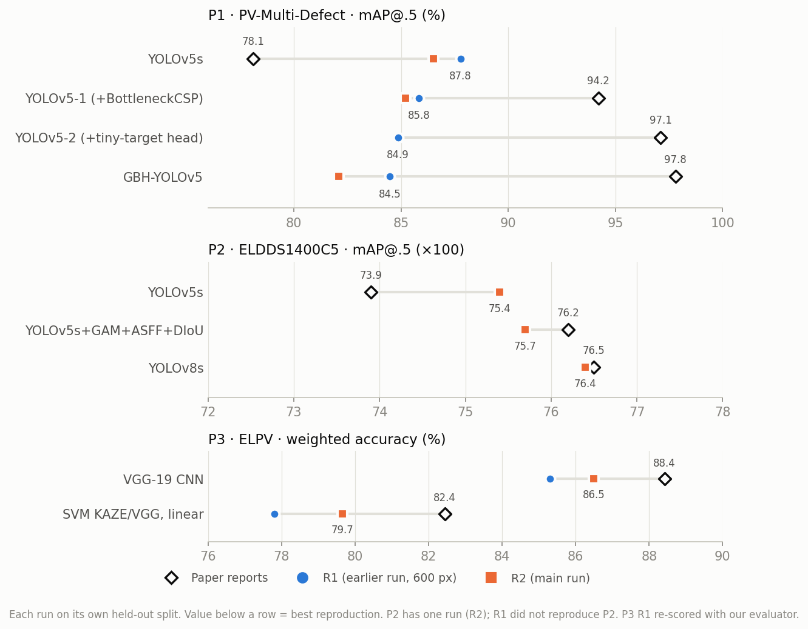
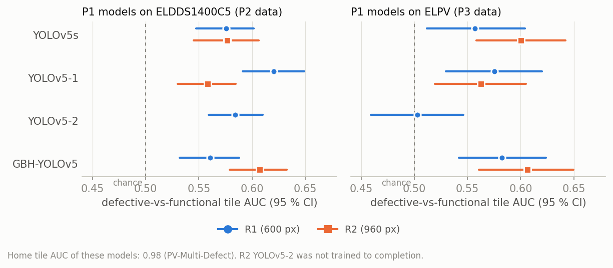

# Do published PV defect models generalise? Reproduction and cross-dataset comparison of three EL-imaging papers

Report for the review paper, 2026-10-23. It combines the reproduction (`CLAIMS.md`), the cross-dataset study
(`COMPARISON.md`) and a second, independent replication of P1 and P3 (R1, §5.1). Every number below can be traced to
a file in `results/`; the scripts are listed in §11.

## Abstract

Three widely cited papers detect or classify defects in electroluminescence (EL) images of photovoltaic (PV)
modules. Each reports high accuracy on its own dataset, and none tests on a second one.
- **P1:** GBH-YOLOv5, mAP@.5 97.8.
- **P2:** an improved YOLOv5 and YOLOv8, mAP@.5 0.76.
- **P3:** a VGG-19 CNN and an SVM on single cells, 88.4 % accuracy.

We retrained every model with the authors' code and settings wherever they were available. We then ran every trained
model, unchanged, on all three datasets and scored them with one evaluator.

**Reproduction.** An audit of every training run against the papers' own statements finds the same code, algorithm
and settings: 34 of 47 items are identical, and 13 are explained by hardware, software or unstated details. Standard models reproduce: within ±0.016 mAP for P2, 2–3 points for P3, and P1's baseline
comes out *higher* than reported. The papers' own architectural improvements do not reproduce:
- P1's GBH-YOLOv5 reaches 84.5 at best, 3.3–4.4 points *below* its own baseline, in two independent runs.
- P2's improved model gains +0.003 over its baseline, not +0.023.

**Transfer.** No model transfers. On foreign data every detector falls from a class-agnostic mAP@.5 of 0.46–0.82 to
0.004–0.053, and the best defective-vs-functional AUC any model reaches is 0.62, against 0.88–0.98 at home. Aligning
the class taxonomies does not repair this. The dominant factor is the image domain, not the architecture.

---

## 1. Motivation

Automated EL inspection is a standard quality-control step in PV manufacturing and field maintenance. Many deep-learning
papers report near-perfect detection, which suggests the problem is solved. A review has to ask two questions before
it can recommend any of these methods:

1. **Are the reported numbers reproducible?** Papers rarely release complete code, splits and weights. Gains of a
   few points from a new module are often reported from a single training run without confidence intervals.
2. **Do the models work outside their own dataset?** A model is only useful to a plant whose camera, module type
   and labelling differ from the authors'. If the papers' datasets differ in field of view, scale and taxonomy, a
   score on one says little about the others, and the papers cannot be ranked against each other by their own tables.

The three papers chosen cover the three common formulations of the task: box detection on module crops (P1), box
detection on whole panels (P2), and classification of single cells (P3). Their datasets are public, so both questions
can be tested.

## 2. Objective

Four research questions:

| RQ | Question | Answered in |
|---|---|---|
| RQ1 | Does each paper's reported performance reproduce with its own code, data and settings? | §6.1 |
| RQ2 | Do the papers' claimed architectural improvements hold when tested with paired statistics? | §6.2 |
| RQ3 | How well does each trained model perform, unchanged, on the other two papers' datasets? | §6.3–6.5 |
| RQ4 | What makes the three papers' results incomparable, and what should a review ask for? | §7 |

**Scope:** inference only for the cross-dataset study. No model is retrained or fine-tuned on a foreign dataset; the
question is what the published models deliver as published.

## 3. The three papers

| ID | Paper | Task | Model(s) | Headline claim |
|---|---|---|---|---|
| **P1** | Li et al. 2023, *GBH-YOLOv5*, Electronics 12, 561 | box detection, 5 classes | YOLOv5s + BottleneckCSP + extra tiny-target head + GhostConv | mAP@.5 **97.8**, +19.7 over YOLOv5s |
| **P2** | Mazen et al. 2023, *Deep Learning for Automatic Defect Detection in PV Modules Using EL Images*, IEEE Access 11 | box detection, 6 classes | YOLOv5s + GAM attention + ASFF head + DIoU-NMS; YOLOv8s | mAP@.5 **0.762** (text: 76.3 %), +2.5 points over YOLOv5s |
| **P3** | Deitsch et al. 2019, *Automatic classification of defective PV module cells in EL images*, Solar Energy 185 | cell classification, defective vs functional | VGG-19 regression CNN; KAZE/VGG + VLAD + linear SVM | CNN **88.42 %** accuracy, SVM 82.44 % |

## 4. Data

| | PV-Multi-Defect (P1) | ELDDS1400C5 (P2) | ELPV (P3) |
|---|---|---|---|
| View | crop of ≈ 4 cell columns, 600 × 600 px | whole 78-cell panel, stretched to 640 × 640 (≈ 85 × 35 px per cell) | one perspective-corrected cell, 300 × 300 px |
| Labels | boxes: broken, hot_spot, black_border, scratch, no_electricity | boxes: Examined (panel outline), ShortCircuitString, ShortCircuitCell, Crack, MicroCrack, OtherError | defect probability per cell, p ∈ {0, ⅓, ⅔, 1} |
| Size | 1108 images, 3981 boxes | 1186 / 190 images used, 21,122 defect boxes | 2624 cells |
| Evaluation split | val 222 (886 / 222) | test 190 | test 656 (1968 / 656) |
| Same as the paper's? | ❌ Same images and split sizes, but the authors' split was never published, 254 scratch/broken boxes are missing from the release, and the raw photos are not released | ✅ Same data (Roboflow upload by the P2 authors); scores match within 0.016 | ✅ Every train/test × type × label count equals P3 Table 3 |

The three datasets share **no class names**, differ in field of view by an order of magnitude, and follow different
annotation conventions (§7). Details: `CLAIMS.md` "Are our datasets identical", `results/dataset_check.md`.

## 5. Method

### 5.1 Two independent replications

| | R1, earlier run | R2, main run |
|---|---|---|
| Papers | P1, P3 | P1, P2, P3 |
| Hardware | RTX 3050 Laptop 6 GB | RTX 4070 Laptop 8 GB (P1); 6 GB laptop GPUs (P2, P3; `init.md` §13) |
| P1 settings | authors' code, Adam lr 0.001, 500 epochs, **600 px**, batch 16 (all models), `last.pt` | authors' code, Adam lr 0.001, 500 epochs, **960 px** (the paper's stated input), batch 16 (YOLOv5s, YOLOv5-1) / 8 × 8 accumulation (GBH), `best.pt` |
| P1 split | 885 / 221 of the 1106 annotated images, membership not saved | 886 / 222 of 1108 (the paper's counts), frozen in `datasets/splits/` |
| P1 models complete | YOLOv5s, YOLOv5-1, YOLOv5-2, GBH-YOLOv5 | YOLOv5s, GBH-YOLOv5; YOLOv5-1 stopped at epoch 203 by a pre-set rule; YOLOv5-2 crashed at epoch 54 |
| P3 | PyTorch VGG-19; linear SVM on KAZE/VGG with K and PCA dimension chosen by train-set CV | Keras VGG-19 (the paper's framework), 3 seeds; linear SVM with paper defaults and with bounded unstated details |
| P2 | — | YOLOv5s, Improved (GAM placement inferred, no code released), YOLOv8s; 100 epochs, batch 16 × 4 accumulation |

R1's weights were found after R2 had finished. We checked them before use: the checkpoint pickles import only
torch, numpy and the YOLOv5 model classes. We then re-scored them with R2's evaluators
(`results/replication_r1/summary.md`).

### 5.2 Which result is reported ("best valid result")

For each model, the report uses the **better of R1 and R2**, counting only results that are valid. A valid result:
- comes from the model's own held-out split;
- is scored by the paper's codebase metric (P1, P2) or by our P3 evaluator;
- used no changed labels and no test images in training.

Results excluded as not valid:
- **R1 P1 models on our val split** (0.91–0.95 mAP@.5). R1 trained on about 80 % of these images.
- **R1's "enlarged boxes" GBH model** (87.3). It changed the labels and was scored on the changed labels. The paper's
  "enlargement" refers to cropping the raw photos, which the released images already have.
- **R1's file `cnn_vgg19.pt`.** It scores the same on its training and test cells (92.3 vs 92.8 % acc_w), so it was
  trained on the test cells (`results/replication_r1/cnn_check.json`).
- **R1's reported CNN figures** (87.86 % / AUC 93.12). Its saved test outputs, which are produced exactly by its
  `cnn_vgg19_paper.pt`, score **85.31 %** with our evaluator. We could not find the weighting that gives 87.86.
- **R1's RBF SVM** (82.0 %). No outputs were saved, and the paper's headline SVM is linear. It is listed as
  supplementary only.
- **P2's TTA at 832 px.** This base size was found after seeing results; 640 px, the paper's stated size, stays primary.

Taking the maximum of two runs scored on different splits flatters the reproduction by about a point. Every verdict
below holds in each run separately, so the choice does not change any conclusion.

### 5.3 Cross-dataset protocol

Every trained model runs on the evaluation split of all three datasets with **its own paper's inference settings**:
- input size: P1 960 px (R1 models 608), P2 640 px, P3 300 px;
- NMS: conf 0.001, IoU 0.6; YOLOv8 IoU 0.7; DIoU-NMS for P2-Improved.

Two shared tasks make every model–dataset pair comparable:
- **Task A, class-agnostic detection** (detectors × 2 box datasets). All defect classes are merged into one;
  ELDDS's `Examined` outline is dropped. Metric: mAP@.5. Variant: **class-mapped detection** on three shared
  classes with a visual counterpart in both datasets: crack (broken ↔ Crack), line (scratch ↔ MicroCrack), dark
  (no_electricity ↔ ShortCircuitString/Cell).
- **Task B, defective-vs-functional tiles** (all models × 3 datasets; P3's task):
  - tiles are ≈ one cell (PV 4 × 4 grid, ELDDS 6 × 6 over the panel, ELPV the cell itself);
  - a tile is defective if a GT defect-box centre lies in it;
  - a detector's tile score is its highest box confidence there; the CNN's is its output on the tile.
  Metric: AUC, plus macro-F1 at pre-declared thresholds (CNN 0.5, detectors 0.25).

One evaluator scores everything: a re-implementation of YOLOv5's `ap_per_class`. It reproduces each codebase's
official mAP within 0.009, and the P3 CNN's home metrics exactly. 95 % CIs come from 1000 bootstrap resamples over
images. Architecture comparisons use **paired** bootstrap differences on the same resamples. Full protocol:
`COMPARISON.md` §1.

### 5.4 Fidelity: does our training use what the papers say?

To be sure that a gap is the paper's and not ours, every training run of R2 was audited against the paper's own
statements. The audit reads each run's own files: the argument list logged when training started, the hyp/opt/args
yaml, the results files, the model summaries, the git state of the codebases and the weight checksums. It does not
use our notes. Script: `code/repro/fidelity_check.py`; full table: `results/fidelity_check.md`.

**Result: 47 items checked. 34 are identical to the paper, 13 are explained deviations, and none differs without a
reason.**

| | Code | Algorithm and settings that match the paper exactly | Explained deviations |
|---|---|---|---|
| **P1** | The **authors' own repository** at its published commit. The only local change is one whitespace character in `train.py` line 1, without which it does not run | Adam; lr 0.001; 500 epochs; 960 × 960 input; COCO yolov5s.pt (v5.0, checksummed); all other hyper-parameters = the repo defaults. YOLOv5s and YOLOv5-1 have exactly the paper's layer and parameter counts (224 / 7.06 M, 228 / 7.15 M); YOLOv5s and YOLOv5-1 use batch 16 | GBH uses physical batch 8 × 8 accumulation (64 images per step, as 16 × 4). GBH uses the authors' released config file unchanged; it gives 290 layers / 7.04 M, not the paper's 270 / 7.24 M, and no public config gives the paper's count. YOLOv5-1 was stopped at epoch 203 by a rule fixed in advance. The split has the paper's counts but not its (unpublished) membership |
| **P2** | ultralytics YOLOv5 **v7.0** and ultralytics 8.0.99 for YOLOv8. Our only addition is one committed patch with GAM, ASFF and DIoU-NMS, implemented from the paper's equations, since no code was released. DIoU is opt-in, so the YOLOv5s baseline trains on stock code | Adam; lr 0.01; 100 epochs; 640 × 640; yolov5s.pt / yolov8s.pt; mosaic off for the last 10 epochs (YOLOv8); all other hyper-parameters = codebase defaults. GFLOPs 16.0 / 28.7 for YOLOv5s / YOLOv8s = the paper | Physical batch 16 × 4 accumulation (64 images per step, as the paper's 32 × 2). The GAM placement is inferred: it was calibrated to the paper's 30.0 GFLOPs. 2 images whose only labels fall outside the 6 classes were excluded (1186 vs 1187 train) |
| **P3** | No code released; the CNN and SVM were implemented from the paper | VGG-19 (ImageNet) + GAP + FC 4096 + FC 2048 + 1, MSE regression; stage 1 Adam (1e-3, 0.9, 0.999, 1e-8) on the new layers; stage 2 SGD (5e-4, momentum 0.9) on all layers; batch 16; 100 + 100 epochs; the paper's augmentation (2 % scale, 3° rotation, 2 % shift, flips, 90° rotations); the paper's confidence weights and macro-F1; Table 3 split counts in all 16 cells | TensorFlow 2.10 instead of 1.4, which cannot run on current GPUs; the same ImageNet weights are used. Output activation linear: the paper doesn't state it, and a sigmoid output did not train. The SVM's codebook size and PCA dimension are not stated, so they were chosen by training-set cross-validation only |

Two independent checks support the audit:
1. **Where the paper fully specifies a model, we hit its numbers.** P1's YOLOv5s and YOLOv5-1 architectures match
   to the layer. P2's YOLOv5s and YOLOv8s land within ±0.016 mAP, and P3's CNN within 2 points.
2. **A second, independent replication (R1) reaches the same results.** It ran on different hardware, at a different
   image size and on a different split.

The deviations are of two kinds:
- **Forced by hardware or software:** physical batch and the TF version. With gradient accumulation, the optimizer
  still sees the paper's 64 images per step.
- **Needed because the paper leaves the detail open or contradicts itself:** the GBH architecture, GAM placement,
  SVM K/PCA and output activation.

None of them can turn a +19.7 gain into −4.4.

## 6. Results

### 6.1 RQ1: Home reproduction

| Paper | Model | Paper | R1 | R2 | **Best valid** | Best − paper |
|---|---|---|---|---|---|---|
| P1 | YOLOv5s | 78.1 | 87.8 | 86.5 | **87.8** (R1) | **+9.7** |
| P1 | YOLOv5-1 (+BottleneckCSP) | 94.2 | 85.8 | 85.2 (203 ep) | **85.8** (R1) | −8.4 |
| P1 | YOLOv5-2 (+tiny-target head) | 97.1 | 84.9 | — | **84.9** (R1) | −12.2 |
| P1 | GBH-YOLOv5 | 97.8 | 84.5 | 82.1 | **84.5** (R1) | **−13.3** |
| P2 | YOLOv5s | 0.739 | — | 0.754 | **0.754** | +0.015 |
| P2 | YOLOv5s+GAM+ASFF+DIoU | 0.762 | — | 0.757 | **0.757** | −0.005 |
| P2 | YOLOv8s | 0.765 | — | 0.764 | **0.764** | −0.001 |
| P3 | VGG-19 CNN, acc_w (%) | 88.42 | 85.31 | 86.49 (3 seeds 85.78 ± 0.76) | **86.49** (R2) | −1.9 |
| P3 | SVM KAZE/VGG linear, acc_w (%) | 82.44 | 77.81 | 79.65 (69.70 with paper defaults) | **79.65** (R2) | −2.8 |

P1 and P2: mAP@.5 from each codebase's own validator. P3: confidence-weighted accuracy, our evaluator.

- **Standard models reproduce or beat the papers.** P2's three models are within ±0.016. P3's CNN is within 2
  points on accuracy. Its macro-F1, which is the paper's definition ("averaged over the individual per-class F1
  scores"), is 84.20 against 88.39. P1's plain YOLOv5s is 9.7 points *above* the paper in R1 and 8.4 above in R2.
- **P1's proposed models are 8–13 points below the paper in both runs.** Our pipeline is not the cause: the same
  pipeline reproduces P1's baseline and P2's models.

### 6.2 RQ2: Do the claimed improvements hold?

| Comparison (at home) | Paper | R1 | R2 | Paired test (R2, our evaluator) |
|---|---|---|---|---|
| P1 YOLOv5-1 − YOLOv5s | +16.1 | −2.0 | −1.3 | — |
| P1 YOLOv5-2 − YOLOv5-1 | +2.9 | −0.9 | — | — |
| P1 GBH − YOLOv5-2 | +0.7 | −0.4 | — | — |
| **P1 GBH − YOLOv5s** | **+19.7** | **−3.3** | **−4.4** | **−0.033 [−0.061, −0.007]** (Holm-corrected: n.s.; class-agnostic −0.055, Holm p 0.025) |
| P1 scratch AP, GBH − YOLOv5s (the tiny-target class) | +28.1 | −1.4 | −2.1 | — |
| **P2 Improved − YOLOv5s** | **+0.023** | — | **+0.003** | +0.003 [−0.008, +0.015] |
| P2 YOLOv8s − YOLOv5s | +0.026 | — | +0.010 | **+0.015 [+0.003, +0.028]** |
| P3 CNN − SVM (acc_w) | +6.0 | +7.5 | +6.8 | — |

- **Every step of P1's ablation chain reverses sign** in R1, the run that completed all four models. Each
  modification costs 0.4–2.0 points instead of adding 0.7–16.1. The tiny-target head does not help the tiny class.
  P1's own tables are inconsistent: its per-class APs average to 81.8 and 97.3 for YOLOv5s and YOLOv5-1, not the
  78.1 and 94.2 it reports, which inflates the gains (`CLAIMS.md` P1).
- **P2's GAM + ASFF + DIoU-NMS is indistinguishable from plain YOLOv5s.** Only YOLOv8s has a home gain whose CI
  excludes 0, and it is small.
- **Multiplicity.** After a Holm correction over all 35 paired tests (`results/cross/tables_holm.md`), only two cross-dataset differences stay significant (GBH − YOLOv5s on ELDDS: +0.017 mAP@.5, +0.031 tile AUC). Within the 15 home-dataset tests, only GBH's class-agnostic deficit (−0.055, Holm p 0.025) stays significant; its class-aware −0.033 (Holm p 0.19) and YOLOv8s's +0.015 (Holm p 0.22) do not. Either way the papers' claimed gains lie far outside every CI, and the sign of
  GBH − YOLOv5s is negative in both independent runs.
- **P3's ranking (CNN > SVM, by ≈ 6 points) holds** in both runs.

### 6.3 RQ3: Cross-dataset detection

Class-agnostic mAP@.5 [95 % CI], R2 models:

| Model | PV-Multi-Defect | ELDDS1400C5 |
|---|---|---|
| P1 YOLOv5s | **0.823** [0.771, 0.868] | 0.035 [0.024, 0.049] |
| P1 GBH-YOLOv5 | **0.768** [0.715, 0.821] | 0.053 [0.040, 0.069] |
| P2 YOLOv5s | 0.008 [0.004, 0.021] | **0.466** [0.378, 0.593] |
| P2 Improved | 0.004 [0.002, 0.007] | **0.464** [0.372, 0.590] |
| P2 YOLOv8s | 0.015 [0.007, 0.032] | **0.479** [0.377, 0.611] |

Bold = home. Class-agnostic ELDDS mAP is lower than P2's class-aware number because 89 % of the merged boxes are
the two hardest classes (MicroCrack, OtherError).

**Mapping the classes does not rescue transfer.** On the shared classes crack / line / dark, cross mAP@.5 is
**0.047–0.133**, against 0.68–0.81 at home:
- **`dark` (an unpowered cell or string) is the only concept that transfers:** P2 → P1 AP 0.13–0.35, on 36 boxes
  (wide CIs). P2's models find 50–56 % of P1's `no_electricity` boxes and call them `ShortCircuitString`.
- **`crack` does not transfer at all** (AP ≤ 0.03). Each dataset's cracks are detected as the other's thin-line class,
  or missed.

### 6.4 RQ3: Defective vs functional, full 3 × 3

| Model | PV-Multi-Defect AUC | ELDDS1400C5 AUC | ELPV AUC |
|---|---|---|---|
| P1 YOLOv5s | **0.977** | 0.577 [0.547, 0.606] | 0.600 [0.555, 0.646] |
| P1 GBH-YOLOv5 | **0.977** | 0.608 [0.582, 0.634] | 0.606 [0.563, 0.650] |
| P2 YOLOv5s | 0.479 [0.439, 0.521] | **0.949** | 0.457 [0.412, 0.504] |
| P2 Improved | 0.499 [0.459, 0.539] | **0.951** | 0.524 [0.479, 0.566] |
| P2 YOLOv8s | 0.484 [0.446, 0.530] | **0.948** | 0.495 [0.451, 0.542] |
| P3 VGG-19 CNN | 0.497 [0.444, 0.554] | 0.591 [0.560, 0.624] | **0.877** |

- **7 of the 12 cross cells are at chance** (the CI includes 0.5).
- **The transfer is asymmetric.**
  - P1's models, trained on zoomed-in crops, keep a weak signal on ELDDS and ELPV (0.58–0.61). On ELDDS they get it
    by flagging most tiles: recall 0.74–0.88 at a precision barely above the defective share.
  - P2's models, trained on whole panels, are at chance on P1 and P3 data.
  - P3's CNN is at chance on P1 data and weakly above chance on ELDDS.
- **The P3 CNN on ELPV under P3's own weighted protocol** scores acc_w 86.49 / AUC_w 90.18. The detectors score
  47.7–64.9 % there, and P2 YOLOv5s's 64.9 % comes from calling almost every cell functional.

### 6.5 RQ3: Does the second replication change the cross-dataset picture?

R1's four P1 models were run on the same foreign test sets with the same code. These numbers are clean for both runs,
since neither saw any ELDDS or ELPV image.

| P1 model | ELDDS mAP@.5, R1 / R2 | ELDDS tile AUC, R1 / R2 | ELPV tile AUC, R1 / R2 |
|---|---|---|---|
| YOLOv5s | 0.014 / 0.035 | 0.576 / 0.577 | 0.557 / 0.600 |
| YOLOv5-1 | 0.043 / 0.034 | **0.621** / 0.558 | 0.576 / 0.563 |
| YOLOv5-2 | 0.050 / — | 0.584 / — | 0.503 / — |
| GBH-YOLOv5 | 0.033 / 0.053 | 0.561 / 0.608 | 0.582 / 0.606 |

- **No run is consistently better.** The paired R1 − R2 differences go both ways:
  - YOLOv5s: tile AUC ties on ELDDS; mAP −0.021 [−0.030, −0.013].
  - YOLOv5-1: +0.063 [+0.041, +0.083] tile AUC on ELDDS.
  - GBH: −0.047 [−0.062, −0.031] tile AUC on ELDDS.
- **No architecture is consistently better either.** Within R1, YOLOv5-1 is above YOLOv5s on ELDDS (+0.045 AUC);
  GBH and YOLOv5-2 are not (−0.015 and +0.009, both n.s.). YOLOv5-2 is below YOLOv5s on ELPV (−0.054).
- **The best foreign AUC in the whole study is R1's YOLOv5-1 on ELDDS, 0.621.** That moves the ceiling from 0.61 to
  0.62, and every P1 model of both runs stays between 0.50 and 0.62. Training resolution (600 vs 960 px), split and
  run make differences of a few hundredths; none changes the conclusion.

### 6.6 Sensitivity of our free choices

- **Input size.** Re-running each detector at the *foreign* dataset's input size changes cross mAP@.5 by ≤ 0.04
  (all ≤ 0.047) and tile AUC by ≤ 0.07.
- **Tile size.** ELDDS tiles of half a cell (12 × 12) instead of two cells leave the home detectors unchanged. They
  drop the CNN's weak ELDDS signal to chance (0.52).

Neither choice changes a conclusion (`COMPARISON.md` §6).

### 6.7 Size and speed (RTX 4050 Laptop, batch 1)

| Model | Params | GFLOPs | ms/img |
|---|---|---|---|
| P1 YOLOv5s | 7.06 M | 36.7 @960 | 11.7 |
| P1 GBH-YOLOv5 | 7.04 M | 58.1 @960 | 16.5 |
| P2 YOLOv5s | 7.03 M | 15.8 @640 | 12.4 |
| P2 Improved | 16.49 M | 29.8 @640 | 24.0 (+ 130 ms Python DIoU-NMS) |
| P2 YOLOv8s | 11.13 M | 28.4 @640 | 12.6 |
| P3 VGG-19 CNN | 30.52 M | 68.9 @300 | 11.7 per cell |

The papers' "improved" models cost 1.6–1.9× the GFLOPs of their baselines, for no measurable gain.

### 6.8 Qualitative examples

On ELDDS, P1's models draw tall thin boxes along cell gaps and busbars and call them `scratch`. On P1's crops,
YOLOv8s draws column-height boxes, its ShortCircuitString shape.

## 7. Discussion (RQ4)

- **Dataset shift dominates architecture.** Within a dataset the architectures differ by ≤ 0.06 mAP@.5. Across
  datasets every model loses 0.46–0.79 mAP@.5 and 0.29–0.49 tile AUC. The architectural claims of P1 (Ghost,
  BottleneckCSP, a fourth head) and P2 (GAM, ASFF, DIoU) say nothing about generalisation, and none of the three
  papers tests on a second dataset.
- **Field of view and scale are the likely first-order mismatch.** A dark cell column is ≈ 150 px wide in P1's
  crops, an ELDDS cell is ≈ 85 × 35 px, and an ELPV cell is 300 px. Resizing does not close the gap (§6.6), so the
  mismatch is in the content of the image, not only its scale. This is an inference: cross-training was not done.
- **The taxonomies are incompatible, but this is the secondary problem.** Only three concepts have a counterpart
  across P1 and P2. Mapping onto them lifts cross mAP only to 0.05–0.13. A shared taxonomy, e.g. the EL defect
  categories of IEC TS 60904-13, is necessary for a benchmark, but it is not enough.
- **Annotation conventions differ:**
  - ELDDS boxes the module outline and thousands of tiny MicroCracks (median 15 × 21 px).
  - P1 boxes hot spots and black borders, which have no ELDDS counterpart.
  - ELPV labels whole cells with uncertain probabilities.

  So the same pixels count as different "defects" in each dataset.
- **Reporting practices inflate results:**
  - P1's tables contradict each other in a direction that enlarges its gains.
  - P2's mAP includes the non-defect `Examined` class at AP 0.995, which adds ≈ 0.05.
  - P2 reports its "2.5 %" gain without a seed spread or CI.
  - Accuracy on imbalanced cell data rewards always answering "functional".

  A review should ask for defect-only mAP, AUC or macro-F1, seed spread, confidence intervals, released splits and
  weights.
- **The one paper that reproduces best is the one that claims least.** P3 makes no architectural claim beyond
  CNN > SVM. Its numbers are within 2–3 points, and it explicitly warns about use outside its setting.

## 8. Conclusion

0. **The reproduction is faithful.** Every training run uses the code, algorithm and settings its paper states:
   34 of 47 audited items are identical, and the other 13 are explained by hardware, software or details the paper
   leaves open (§5.4). The gaps below are therefore the papers', not the reproduction's.
1. **Reproducibility (RQ1).** Standard models reproduce. P2's YOLOv5s / YOLOv8s are within ±0.016 mAP, P3's CNN
   within 2 points, and P1's YOLOv5s scores 87.8 against 78.1 reported. P1's proposed GBH-YOLOv5 reaches at most
   84.5 against the claimed 97.8, in two independent runs on different hardware, image sizes and splits.
2. **Claimed improvements (RQ2).** They do not hold:
   - P1's ablation chain reverses sign at every step, and GBH lands *below* its own baseline in both runs (−3.3 and
     −4.4; class-agnostic deficit significant after Holm correction).
   - P2's GAM + ASFF + DIoU-NMS gains +0.003 (n.s.), not +0.023.
   - Only P3's CNN > SVM ranking, which is not an architectural novelty, is confirmed.
3. **Generalisation (RQ3).** None of the 11 models tested across datasets (7 from R2, 4 from R1) works on another
   paper's data:
   - cross mAP@.5 is 0.004–0.053;
   - the best foreign tile AUC is 0.62;
   - 7 of 12 cross cells are at chance.

   The only concept that carries over is a dark, unpowered cell or string. A second replication confirms this
   picture.
4. **Comparability (RQ4).** The three papers' numbers measure performance on three different problems: different
   field of view, scale, taxonomy and annotation. They cannot be ranked against each other. For practice, every
   published model needs labelled in-domain data before deployment; the papers' numbers are upper bounds for their own
   acquisition setup.
5. **For the field.** The gap is a **cross-dataset EL benchmark** with a shared taxonomy, varied acquisition (crop /
   panel / cell, different cameras and module types), released splits and multi-seed reporting. Without it,
   architectural gains of a few points cannot be distinguished from dataset artefacts.

## 9. Limitations

- **Inference only.** Cross-training (every architecture retrained on every dataset) would separate architecture from
  training data and was not done.
- **One training run per detector per replication.** Paired CIs cover test-set sampling, not seed variance; the P3
  CNN's seed spread is ±0.76 acc.
- **P1's data is not the authors' data** (missing boxes, unpublished split). This explains part of the scratch gap,
  but not the inverted ablation.
- **P1's GBH architecture cannot be rebuilt exactly.** No public configuration gives the paper's 270 layers / 7.24 M
  parameters. P2's GAM/ASFF placement is inferred, because no code was released.
- **The tile task and the class map are our constructions** (sensitivity in §6.6).
- **"Best valid result" takes the higher of two runs on different splits.** It is optimistic by about a point and
  never changes a verdict (§5.2).
- **R1's provenance is limited.** Its code is not in the folder, so its training could only be checked through its
  logs, options and saved outputs.

## 10. Run inventory

**Training runs (home datasets).** Settings: R1 600 px, batch 16, `last.pt`. R2 P1 960 px, `best.pt`.

| Run | Model | Epochs | Status | Weights |
|---|---|---|---|---|
| R1 | P1 YOLOv5s | 500 | done | R1 folder `abl_yolov5s/last.pt` |
| R1 | P1 YOLOv5-1 | 500 | done | `abl_yolov5s_1/last.pt` |
| R1 | P1 YOLOv5-2 | 500 | done | `abl_yolov5s_2/last.pt` |
| R1 | P1 GBH-YOLOv5 | 500 | done | `pv_gbh_b16/last.pt` |
| R1 | P3 CNN (PyTorch) | 100 + 100 | done | `deitsch2019/cnn_vgg19_paper.pt` |
| R2 | P1 YOLOv5s | 500 | done | `models/p1/yolov5s.pt` |
| R2 | P1 GBH-YOLOv5 | 500 | done | `models/p1/gbh_yolov5.pt` |
| R2 | P1 YOLOv5-1 | 203 / 500 | stopped by pre-set rule (no sign of the claimed gain by epoch 200) | `models/p1/yolov5_1.pt` |
| R2 | P1 YOLOv5-2 | 54 / 500 | crashed; resume pending | — |
| R2 | P2 YOLOv5s / Improved / YOLOv8s | 100 each | done | `models/p2/*.pt` |
| R2 | P2 GAM-only, ASFF-only, DIoU-only | — | pending | — |
| R2 | P3 CNN (Keras), seeds 0–2 | 100 + 100 | done | `models/p3/cnn_vgg19_seed*.h5` |
| R2 | P3 SVM, paper defaults / bounded | — | done | `models/p3/svm_*.npz` |

**Cross-dataset inference runs.** Every row is one model on the three test sets; predictions are in
`results/cross/preds/` and `results/replication_r1/preds/`.

| Model | PV-Multi-Defect val 222 | ELDDS test 190 | ELPV test 656 | Tasks |
|---|---|---|---|---|
| R2 P1 YOLOv5s, GBH-YOLOv5 | home | cross | cross | A, B, class-mapped |
| R2 P1 YOLOv5-1 | home | cross | cross | A, B (§6.5 only) |
| R2 P2 YOLOv5s, Improved, YOLOv8s | cross | home | cross | A, B, class-mapped |
| R2 P3 VGG-19 CNN | cross (tiles) | cross (tiles) | home | B |
| R1 P1 YOLOv5s, YOLOv5-1, YOLOv5-2, GBH | leaky (not used) | cross | cross | A, B (§6.5) |
| Sensitivity S1: R2 detectors at the foreign input size | cross | cross | — | A, B |
| Sensitivity S2: all models, ELDDS 12 × 12 tiles | — | all | — | B |

## 11. Reproduce and files

- **Main study:** `COMPARISON.md` §10 (`code/repro/cross/`). Claim-by-claim check: `CLAIMS.md`. Dataset check:
  `code/repro/check_datasets.py`.
- **Fidelity audit (§5.4):** `envs/p1/Scripts/python.exe -I code/repro/fidelity_check.py`. Output:
  `results/fidelity_check.md`.
- **Second replication:**
  - `bash code/repro/replication/run_r1_dumps.sh <R1 folder>`, then
    `envs/p3cnn/Scripts/python.exe -I code/repro/replication/r1_eval.py <R1 folder>`. Output:
    `results/replication_r1/summary.{md,json}`.
  - `envs/p1/Scripts/python.exe -I code/repro/replication/r1_cnn_check.py <R1 folder>`. Output:
    `results/replication_r1/cnn_check.json`.
  - `envs/p3cnn/Scripts/python.exe -I code/repro/replication/figs.py` draws Fig. 9 and Fig. 10.
- **R1 weights** live outside the repo, in `trained_weights_and_results/` (3 GB), and are not committed.
